# DEMOCARE: Documentation for adapting the model to other countries

Daniel Devolder

3 October 2026

> This file is generated from *Democare 2026.docx* (with all tracked changes accepted). The Word file is the master copy: edit the Word file and regenerate this one, rather than editing this file by hand.

## Contents

- [Introduction](#introduction)
- [Kinship network microsimulation model: KINFERT](#kinship-network-microsimulation-model-kinfert)
  - [Files with separation and second unions](#files-with-separation-and-second-unions)
  - [Zipped files](#zipped-files)
- [Simulating the need for care](#simulating-the-need-for-care)
  - [Probabilities of falling into a disability state](#probabilities-of-falling-into-a-disability-state)
  - [Transition in and from the labour market](#transition-in-and-from-the-labour-market)
  - [Hours of care needed and available in the family](#hours-of-care-needed-and-available-in-the-family)
  - [Simulation of family care](#simulation-of-family-care)
  - [Rules for giving or receiving care in the family network](#rules-for-giving-or-receiving-care-in-the-family-network)
  - [Separation and second unions (R version)](#separation-and-second-unions-r-version)
  - [Variables used in the simulation and variables written to the output file](#variables-used-in-the-simulation-and-variables-written-to-the-output-file)
  - [Bootstrapping](#bootstrapping)
- [Analysing results and doing plots](#analysing-results-and-doing-plots)
- [Using the computeCare Shiny app](#using-the-computecare-shiny-app)
- [Acknowledgements](#acknowledgements)
- [References](#references)

## Introduction

DEMOCARE is made of three modules:

1\. A general program to simulate kinship networks. Think of it as a simulation model for generating genealogies, at the moment up to the fourth degree (that’s a lot of kin\!).

The program can be downloaded here: https://github.com/ddev2/KINFERT. The source is free for everybody. It has an option to generate the specific kinship data we used for DEMOCARE: persons (ego) aged exactly 50 years, with their close kin, those who can provide care to egos.

2\. A program that reads that information, which we can consider as families, and essentially project it forward in time. It also uses a lot of other inputs: probability of falling into a state of dependency, probability of entering, staying or exiting the labour market, number of hours of care needed by and available from each individual. The projection of all the family members allows us to compute each year who is available to care for egos, taking into account that other family members may also need care.

This module is written in R. A first version was written in NetLogo, a language chosen because it makes it possible to model interactions at the group level, between families, since all families are simulated at the same time and are held together in memory. That was more than the project needed. The module has since been rewritten in R, and the NetLogo version is still described in several places below, because the R code follows its logic and writes the same output format.

3\. Code in R to analyse the output of the preceding simulation and create plots.

## Kinship network microsimulation model: KINFERT

It uses sets of cohort demographic parameters. The data can be entered through a dialog (visible in the next figure) if the simulation uses only data for one cohort (a stable population simulation). If the demographic parameters can vary by cohort, then the data is read from a text file that can be created in Excel (second figure). I include an Excel file (cohort\_values.xlsx) as well as the resulting text file read by KINFERT (cohort\_values.txt). The data corresponds to the Spanish demographic regimes used in our simulations. The Spanish levels of fertility, nuptiality and mortality are for cohorts born in Spain at ten-year intervals from 1688 to 2098. The estimates for the cohorts born during the Seventeenth to the Nineteenth centuries are rough approximations, while the estimates for the Twentieth century are closer to real values. The levels for cohorts born during the Twenty-first century are projected values.

Figure 1. Main dialog for entering and visualizing demographic parameters

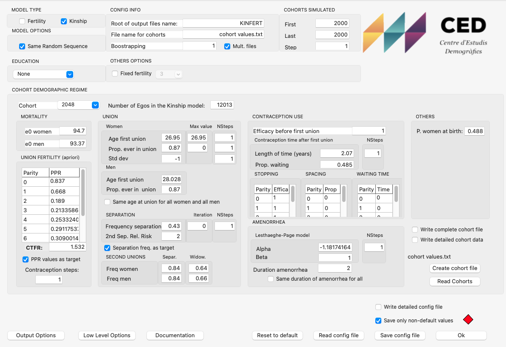

The demographic parameters are of two kinds: general ones like life expectancy at birth, age at first union, etc, and very specific and detailed ones, mainly related to fertility, that can be left at their standard value. The general group is made of the following parameters, for each cohort:

1.  Number of egos or genealogical trees simulated for each cohort

2.  Life Expectancy at birth for women and for men

3.  Proportion of women and men who ever enter a union and age at first union

4.  Fertility of women in union in terms of Parity Progression Ratios (probability of having a first birth, probability of having a second birth for the women who had a first one, etc.). This is something quite specific, but rather important for the simulation. Usually, fertility level is given as a Total Fertility Rate (TFR). In the model we use instead these probabilities for women in union

5.  Probability of separation for the first and later unions

6.  Probability of re-partnering for women and men, differentiating between the motive of the previous dissolution (separation or widowhood)

The second group starts with parameters that define the waiting times for having children for women in union: length of the period of use of contraceptives after the start of the union, after the first birth, the second, etc, and proportion who use contraceptives. This is important for the spacing of births. The most important one is for the postponement of the first birth.

There are then parameters which are very specific, that define the contraceptive efficiency, for unwanted fertility and also the waiting time after a childbirth, that can be left at their standard value.

Figure 2. Excel file used for creating sets of cohort demographic parameters for a variable fertility and mortality simulation

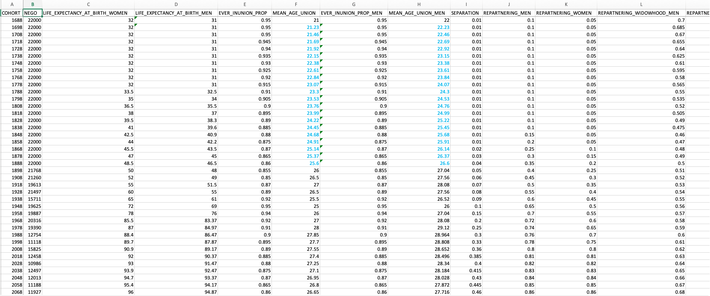

Note: file cohort\_values.xlsx.

The simulation then starts, creating the genealogies with the depth needed (next figure).

Figure 3. Relatives simulated starting with ego, each with their own dates of birth and death and reproductive life

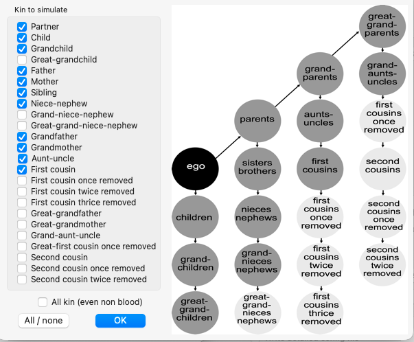

For DEMOCARE the list of relatives needed is short: egos, partners, children, grandchildren. Other relatives can be added if needed: ego’s father and mother and partner’s parents as well, if there is a need to take into account care given to the parents of the central couple (ego and partner). The model outputs two different files: a list of kin (Figure 4) and a list of links between kin (Figure 5).

Figure 4. List of relatives generated by KINFERT for DEMOCARE

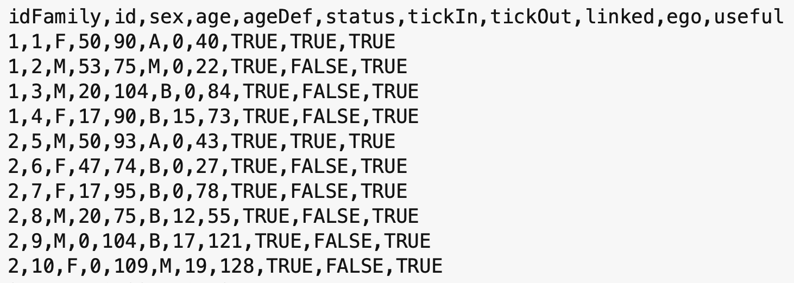

Note: file: Population 0.1.txt

In the file in the attached folder (Population 0.1.txt), the list of kin extends over 65 000 lines for 10 000 egos. The variables in that list are:

1.  idFamily: the family number

2.  id: the unique number for each kin

3.  sex: either F (Female) or M (Male)

4.  age: age at the start of the simulation, when egos are aged 50 years

5.  ageDef: age at death (also for a partner who leaves the simulation through a separation: tickOut is then the year of the separation, but ageDef is still the age at death; see “Files with separation and second unions” below)

6.  status: Educational level, here coded in Catalan (A: alt, high; M: mitja, medium; B: baix, low)

7.  tickIn: the year when the kin entered the simulation (if the value is \> 0, it can be a birth or a union)

8.  tickOut: the year when she/he exited the simulation (due to death or to a separation). A partner who separates from a blood relative of ego leaves the simulation in the year of the separation and is not followed afterwards

9.  linked: whether the ego has a family (TRUE) or is alone (FALSE)

10. ego: whether the kin is an ego (TRUE) or another type of kin (FALSE)

11. useful: the kin can be used in the care simulation (normally always TRUE)

We can observe in the preceding list that we have two “families” (or networks): from id 1 to 4 and from id 5 to 10: a “family” always starts with an ego. The old file format version didn’t have and idFamily family number, while the new format starts with an idFamily. Both the Netlogo model and the R versions accept the two file formats.

Figure 5 shows the family links (file: links 0.1.txt) corresponding to the two preceding families:

1.  Links of type “M” correspond to “marriage” or union. This type of link is symmetric, as each couple has two links: one from the man to the woman and another one from the woman to the man. There is no special reason why we need two links there, and future versions of the DEMOCARE file format may retain only one link, which should always be from a blood relative of ego toward a non-blood one.

2.  Links of type “D” correspond to “descendant”. It always starts from a woman, the mother, and we have only one link with each one of her children.

Each link contains two family members, with their id, the type of link and the family number.

Figure 5. List of family links corresponding to the previous list of relatives

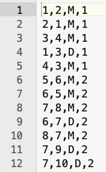

Note: file: Links 0.1.txt

There is no header to the family link file. The columns are:

1.  id of a first relative in the main population file

2.  id of a second relative

3.  Type of link: M is for a union, D is for a descendance link

4.  idFamily: the family number

If we have a look at each individual of the first family, we find:

1.  id=1, this is ego who is a woman, whom we observe from age 50 until her death at age 90. She has a high educational level. She enters the simulation at time 0 and leaves it at time 40, when she dies. She has kin in her network

2.  id=2, is a man, partner of ego, aged 53 when the simulation starts, 3 years older than her, who dies at age 75, and therefore is present in the simulation from year 0 to 22. We can see that because there are two links of type M, one going from ego to her partner (1,2,M,1) and another one from the partner to ego (2,1,M,1)

3.  id=3 is a son, as there is the link (1,3,D,1): from ego, who is the mother of a son of id 3. The son enters the simulation at year 0, meaning he was born before, and exits when he dies at age 104, in year 84

4.  id=4 is the son’s partner. She enters the simulation at year 17, when she forms a union with the son. She exits at year 73, when she dies

We observe that the main couple had only one surviving son, who in turn didn’t have any children. In the second family the main couple had one girl who in turn formed a union when ego was aged 62 years, and had two children, born when ego was aged 67 and 69 years.

Therefore, we have all the information for the families or kin networks, as generated by KINFERT. The simulation operates on each family separately and stops when ego dies.

### Files with separation and second unions

KINFERT can be run with the separation option (see the probabilities of separation and of re-partnering in the list of parameters above). The file format is then exactly the same as the one described above: the same columns in the population file, and the same four columns, without header, in the links file. The only difference is that a blood relative of ego (ego, or one of ego’s children) can now have more than one link of type M, one for each union. Two unions of the same person never overlap in time: a new partner only enters the simulation after the previous one has left it.

Each partner appears in the population file only for the duration of the union. tickIn is the year the union starts (0 if it started before the beginning of the simulation) and tickOut is the year it ends, either because the partner dies or because the couple separates. A separated partner leaves the simulation at the separation and is not followed afterwards: from that year on, he or she neither gives nor receives care. The blood relative of ego, on the other hand, stays in the simulation and may form a new union later. ageDef is still the age at death of the partner, so that a partner who separates can be recognised by the fact that he or she leaves the simulation before reaching the age at death (age + tickOut \< ageDef).

Only the biological relatives of ego are included in the file. Children that a partner may have had with someone else (stepchildren of ego) are not generated by KINFERT. Every child linked by a D link to one of ego’s partners is therefore a child of ego, and every child linked to one of the partners of ego’s son is a grandchild of ego. Since D links always start from the mother, the children of a man can be linked to several women, one for each union in which he had children.

As an example, consider a family made of the following individuals (it is part of the small test file used to check the R code, see “Separation and second unions (R version)” below):

  - id=1 is ego, a man aged 50 at the start of the simulation, who dies at tick 35, aged 85.

  - id=2 is ego’s first partner, a woman aged 48 at the start, present from tick 0 to tick 10. Her age at death (ageDef) is 90, while she is only 58 at tick 10 (age + tickOut = 48 + 10): the union therefore ends with a separation at tick 10, not with her death.

  - id=3 is ego’s second partner, aged 45 at tick 0. She enters the simulation at tick 12, two years after the separation, and stays until tick 35, when she dies at age 80 (45 + 35 = 80).

  - id=4 is a son of ego and of his first partner (link 2,4,D,1), born before the start of the simulation; id=5 is a daughter of ego and of his second partner (link 3,5,D,1), born at tick 14.

  - The links file contains four M links for ego, one pair for each union: 1,2,M,1 and 2,1,M,1 for the first union, 1,3,M,1 and 3,1,M,1 for the second.

In this family, ego is married from tick 0 to tick 9, separated at ticks 10 and 11, and married again from tick 12 until his death. Both id=4 and id=5 are ego’s children, whichever partner is their mother.

### Zipped files

KINFERT files are now usually delivered zipped. The R model itself reads plain text files, but the computeCare Shiny app accepts zipped files directly (see “Using the computeCare Shiny app” below). For a population file named X\_indKin.txt, any of the following layouts can be used:

  - one zip file, X\_indKin.zip, containing both X\_indKin.txt and X\_indKin\_link.txt;

  - two zip files, X\_indKin.zip and X\_indKin\_link.zip (or X\_indKin.txt.zip and X\_indKin\_link.txt.zip), one for each file;

  - a zipped population file with a plain links file next to it (X\_indKin.zip and X\_indKin\_link.txt);

  - a plain population file with a zipped links file next to it (X\_indKin.txt and X\_indKin\_link.zip);

  - two plain text files, as before.

The zip files are never modified. When a zip file is selected, the app extracts the population and links files into a temporary folder outside the project, runs the simulation or the bootstrap on these copies, and deletes the temporary folder at the end, also when the run fails. The project folder is therefore left exactly as it was, with the zipped files only: there is nothing to zip again afterwards. The “\_\_MACOSX” and “.DS\_Store” entries that the macOS Finder adds to a zip file are ignored. Only the unzip() function of base R is used, so no additional package or program is needed. To run computeCare\_baseR.R on its own, outside the app, the files must still be unzipped by hand.

## Simulating the need for care

The module which simulates the life of families, starting with egos aged 50 years, needs a series of inputs that are obtained from other sources. There are three sets of inputs:

  - Disability risks obtained from a Health or Disability survey.

  - Labour force participation rates and derived transitions obtained from a Labour Force Survey.

  - Numbers of hours of care needed and available for family members, according to their age, level of dependency and labour force activity status.

### Probabilities of falling into a disability state

We need first information about disabilities which force people to rely on the help of other persons. The idea behind DEMOCARE is to check whether families can provide the amount of care needed, which is known in the literature as “informal care”. If family members cannot provide enough hours of care, then the disabled persons will need help outside the family, usually from professionals, which corresponds to what is called “formal care”.

Therefore, the first input needed by DEMOCARE is a set of probabilities of falling into disability states. These probabilities are obtained from health surveys or specialized disability surveys. For example, in Spijker, Devolder and Zueras (2022) we used the Spanish 2008 Survey on Disability, Personal Autonomy and Dependency Situations (acronym EDAD2008), as documented there. We constructed two sets of probabilities from this survey:

1.  A set of proportions of type stock which serves at the start of the simulation: the proportions of persons disabled, by age, sex, educational level and disability state, as shown in Figure 6. The left pane shows the first lines of the file and the right pane is a pivot table for the High educational level (A), for women (F), by age, starting at 20 years up to 105 years. For example, at age 20, 99.45% of the women with a high educational level have no disability (type 0), 0.33% have a disability of type 1, 0.14% of type 2 and 0.08% of type 3. We observe that the proportion of persons without disability goes down to 98.27% at age 33, while the proportion of persons with disability goes up (this is an important observation, used to build the second set of probabilities). Persons aged less than 20 years are given the disability level of a person aged 20. This is a deliberate recode, held in the model as the variable ageRecDep and described in Calduch Verdiell et al. (2017). The survey does in fact record disability at all ages; the reason for the cut-off is that the number of cases below age 20 is very small, so the prevalences computed from them would be unstable. Age 20 is also close to the ages at which union formation and family building begin in the model. Observe also that we have a column for CCAA, which means “Comunidades Autónomas” in Spanish. The value is always “Total”: no regional analysis here, the data is only for whole Spain.

> Figure 6. Initial proportions of disability by age, sex and educational level

| 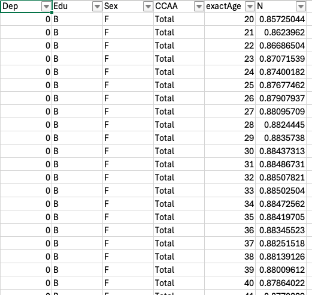        | 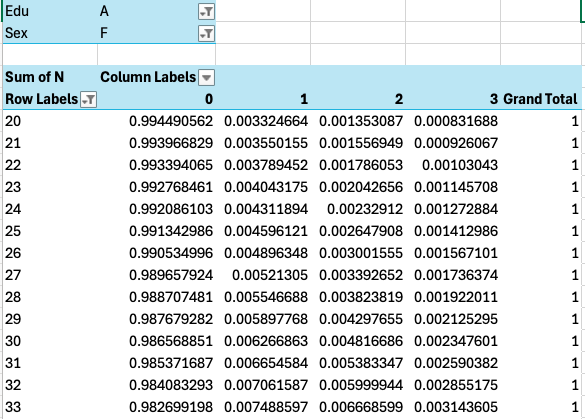 |
| ------------------------------ | ----------------------- |
| Note: file: dependency 0.1.csv |                         |

2.  The second set are transition probabilities by age, sex and educational level, shown in Figure 7. The left pane shows the first lines of the file and the right pane the set of probabilities between disability states. These transition probabilities are computed directly from the previous distribution as if it were a synthetic cohort. The table of transition probabilities is obtained by solving a 4x4 system of linear equations, for each sex, age and educational level in a separate way:

\[\left\{ \begin{matrix}
\Delta p\left( 0 \right) = {- m}_{0 \rightarrow 1} \\
\Delta p\left( 1 \right) = m_{0 \rightarrow 1} - m_{1 \rightarrow 2} \\
\Delta p\left( 2 \right) = m_{1 \rightarrow 2} - m_{2 \rightarrow 3} \\
\Delta p\left( 3 \right) = m_{2 \rightarrow 3} \\
\end{matrix} \right.\ \]

> Where \(p\left( i \right)\) is the proportion of persons of age x with the dependency level \(i\) obtained from the previous table, \(\Delta p\left( i \right)\) is the variation of this proportion between age \(x\) and \(x + 1\), and \(m_{i \rightarrow i + 1}\) is the proportion of persons of age \(x\) whose dependency level changed from \(i\) to \(i + 1\) before age \(x + 1\).
> 
> Therefore, the unknowns are the values \(m_{i \rightarrow i + 1}\) and the known quantities are the proportions \(p\left( i \right)\) obtained directly from the disability survey. Transition probabilities used in the simulation are then computed as \(\frac{m_{i \rightarrow i + 1}}{p\left( i \right)}\)
> 
> The key assumption which allows us to compute these probabilities from only one survey is that dependency status can only increase (and the health condition gets worse) with age and the progression is always from a dependency level to the immediately following one (i.e. nobody can jump from dependency level 0 to 2 or 3). Another implicit assumption is that mortality risks used by the kin microsimulation model do not depend on the dependency level, which is probably wrong, as mortality risks possibly increase with the dependency level.
> 
> Figure 7. Transition probabilities between disability states by age, sex and educational level

|                         |                         |
| ----------------------- | ----------------------- |
| 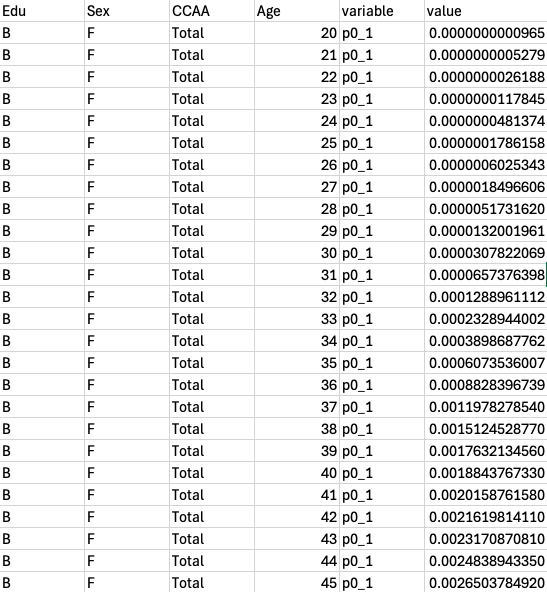 | 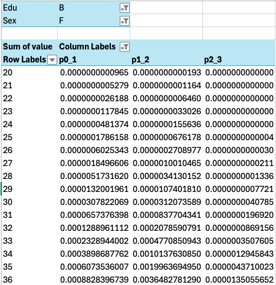 |

> Note: file: dependency\_transitions 0.1.csv

### Transition in and from the labour market

The second set of inputs for the simulation is the labour force participation of the individuals. If an ego needs care, but all her/his relatives work, then the availability of informal care will be very reduced, and the family will need external help from professionals, i.e. formal care.

As with the disability data, the model uses two sets of probabilities for labour force participation: a set of type stock, used at the start of the simulation, and a set of type flow, made of probabilities of transitioning between states. The main difference between these last probabilities and the ones used for the transition between disability states is that they are reversible: you can enter but you can also exit the labour market, and you can also switch between full-time and part-time occupations. This explains why we also need to use two datasets, in our case two rounds of the Spanish Labour Force Surveys.

Figure 8 presents on the left pane the first lines of the first set, obtained from the Spanish 2008 Survey EDAD2008: proportions of persons by age, sex, dependency level (0,1,2,3), educational level (A,M,B) and activity type (A,C,P):

  - A: no activity

  - C: active, full time

  - P: active, partial occupation

The right pane shows the same data summed over activity types: it is a distribution of men by age, no dependency, high educational level, which we visualize with the plot in Figure 9. We observe that the age range spans from 0 to 105 years, and the activity begins at age 16 and concludes at age 75.

Figure 8. Initial proportions of activity by age, sex, type, educational and disability level

|                          |                          |
| ------------------------ | ------------------------ |
| 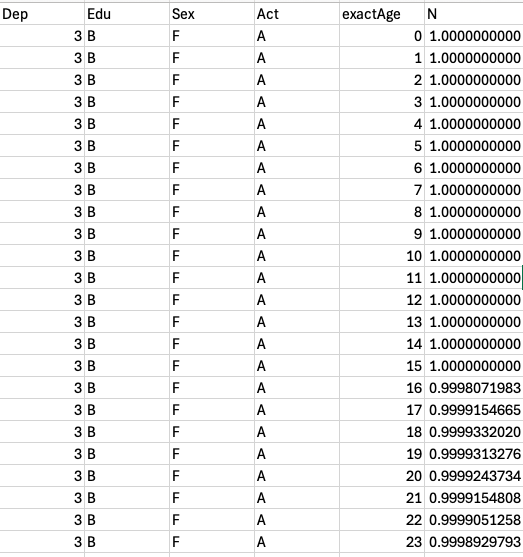 | 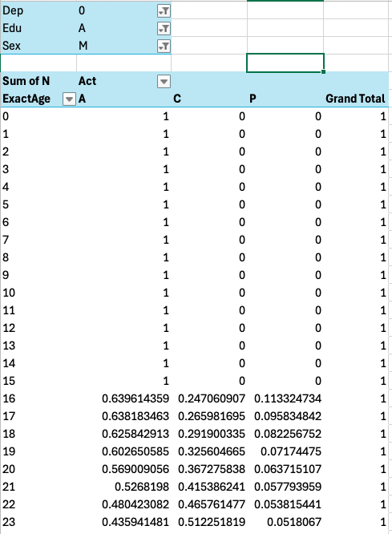 |

Note: file: activity 0.3.csv

Figure 9. Initial proportions of activity by age, sex, type, educational and disability level

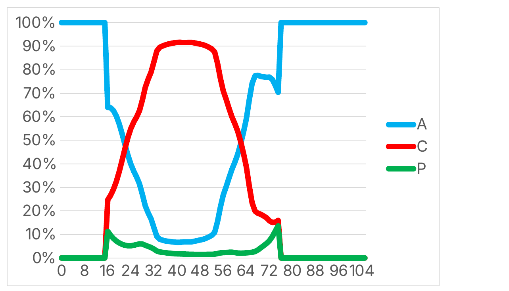

<span class="chart">\[CHART\]</span>

We use the labour force participation distribution of the population aged 16 years and more by sex, age, educational level and dependency status to obtain a multistate table of transitions between three labour force activity statuses (not working, working part-time and working full-time). Each year of the simulation, transitions can happen between any two activity statuses and in both directions. So, we have a linear system of only 3 equations with 6 unknowns. In order to estimate these probabilities, we use extra information from the Spanish Labour Force survey (EPA) from two consecutive waves (2nd quarter of 2007 and of 2008 in our original simulation, as shown in Figure 10) from which we compute the transition probabilities between labour force activity status by single year of age and sex. Transition probabilities of changes between the three activity states are then computed separately for each sex, age, educational level and dependency status in an iterative way.

Figure 10. Individual data from the Spanish Labour Force Surveys of 2007 and 2008

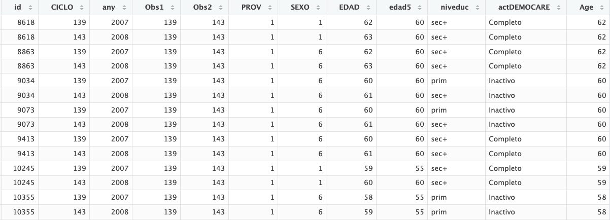

Note: Each individual, with identifier *id*, occupies two lines. They are observed here in 2007 and 2008, in the same trimester, with sex *SEXO*, age *EDAD* and three educational levels in column *niveduc*. Each individual is observed at age x and age x+1, as shown in column *EDAD*. The activity status at time of each survey corresponds to column *actDEMOCARE* (we observe no change in activity for the individuals shown in this table). The Labour Force Surveys provide panel data, so as individuals are observed during 4 trimesters. We use here only individuals observed during year 2007 who were observed 4 trimesters later in year 2008.

First, we estimate the set of 6 proportions of persons at age x (of the same sex, educational level and dependency status) whose activity status changed (varied) before age x+1 using EPA transition probabilities by sex and age:

|                                                                                                                                                   |       |
| ------------------------------------------------------------------------------------------------------------------------------------------------- | ----- |
| \[{\mathrm{\Delta}p}_{s,x,e,d}\left( a \rightarrow b \right) = p_{s,x,e,d}\left( a \right).m_{s,x,e}^{\text{EPA}}\left( a \rightarrow b \right)\] | \[1\] |

> Where \(p_{s,x,e,d}\left( a \right)\) is the proportion of persons of age x, of sex s, of education level e and with dependency status d who were in labour force activity state a; \({\mathrm{\Delta}p}_{s,x,e,d}\left( a \rightarrow b \right)\) is the variation of this proportion between age x and x+1 due to a change in activity status from a to b; \(m_{s,x,e}^{\text{EPA}}\left( a \rightarrow b \right)\) is the transition probability at age x, for sex s and educational level e, between labour force activity status a to b, as observed in the Spanish Labour Force survey between the 2nd quarter of 2007 and the 2nd quarter of 2008.

These variations of the proportion between age x and age x+1 are then used to derive an estimate of the proportions by labour force activity status at age x+1 attained if the transition probabilities had been those observed from the EPA survey. We compare these estimated proportions at age x+1 with their observed level and use the relationship between the two to correct the set of \({\mathrm{\Delta}p}_{s,x,e,d}\left( a \rightarrow b \right)\) numbers:

|                                                                                                                                                                                                                 |       |
| --------------------------------------------------------------------------------------------------------------------------------------------------------------------------------------------------------------- | ----- |
| \[\mathrm{\Delta}p_{s,x,e,d}^{*}\left( a \rightarrow b \right) = {\mathrm{\Delta}p}_{s,x,e,d}\left( a \rightarrow b \right).\frac{p_{s,x + 1,e,d}\left( b \right)}{\widehat{p_{s,x + 1,e,d}\left( b \right)}}\] | \[2\] |

This allows us to compute a new set of transition probabilities:

|                                                                                                                                                          |       |
| -------------------------------------------------------------------------------------------------------------------------------------------------------- | ----- |
| \[m_{s,x,e,d}^{*}\left( a \rightarrow b \right) = \frac{\mathrm{\Delta}p_{s,x,e,d}^{*}\left( a \rightarrow b \right)}{p_{s,x + 1,e,d}\left( a \right)}\] | \[3\] |

This new set is plugged in equation \[1\] and we iterate through \[1\] to \[3\] until \(\sum_{a}^{}\left( p_{s,x + 1,e,d}\left( a \right) - \widehat{p_{s,x + 1,e,d}\left( a \right)} \right)^{2}\) reaches a minimum.

There is R code that processes that information and smooths it, using loess. The input data is the following:

  - The distribution of activity states by sex, age, educational and dependency levels, the numbers \(p_{s,x,e,d}\left( a \right)\) are obtained from a disability survey similar to EDAD2008.

  - Two merged labour force survey datasets separated by one year that allow the computation of the set of transition probabilities \(m_{s,x,e}^{\text{EPA}}\left( a \rightarrow b \right)\).

Two R scripts carry out these calculations. “compute\_activity\_transitions.R” reads the raw two-wave Labour Force Survey data and works out, for each age and sex, how often people moved between the three activity states within one year. “smooth\_actividad.R “ then combines this with the health survey's activity table and produces the two files described below, which are the files actually read by the simulation.

The scripts use two input files. “actividad.RData” is the health survey table already used for disability (Figure 6): for each age, sex, education level and dependency level, it gives the proportion of people in each of the three activity states. “EPA\_survey.RData” is the Labour Force Survey data: one row per person per interview, kept only for people who were interviewed twice, one year apart, with their activity status recorded each time. As noted above, the Labour Force Survey does not record dependency level, so on its own it can only give transition rates for the population as a whole; closing that gap, separately for each dependency level, is exactly what the iterative procedure in equations \[1\] to \[3\] does, using the health survey's dependency-specific numbers as the target to match.

The scripts produce two output files, both organised by age, sex, education level and dependency level. activity.csv gives the proportion of people in each of the three activity states for each combination; this is the file used to set every individual's activity status at the start of the simulation. act\_transitions.csv gives the probability of moving from one activity state to another within a year; this is the file used every year of the simulation to decide whether, and how, each individual's activity status changes.

One detail in act\_transitions.csv is worth explaining, as it is not obvious from the numbers alone. From any activity state there are only two possible destinations: someone not working, for instance, can move to part-time or to full-time work, but not both. Each year, the simulation decides whether an individual's activity changes by drawing a single random number between 0 and 1. To make a choice between three outcomes (stay, or move to one of two other states) from just this one number, the file does not store the two destination probabilities separately: it stores the first one on its own, and the second one added to the first, as a running total. The random number is then compared against these two values in turn: below the first, the individual moves to that destination; below the second but not the first, they move to the other destination; otherwise, they keep their current activity. This differs from the disability transitions described earlier, where change can only go in one direction and a single probability is therefore enough; because activity is reversible, with two possible destinations, this small addition keeps the simulation to one random draw per person per year for this step as well.

In technical terms, we have the following algorithm:

For determining whether an activity transition occurs, the Netlogo program draws a single random number (dice) and picks the new activity with two nested threshold tests:

```
if (dice < refValueChangeH) [
  ifelse (dice < refValueChangeL) [ → destination 1 ]
  [ → destination 2 ]
]
; else: no transition, stays in current activity
```

That's the classic one-draw, cumulative-CDF sampling trick for a 3-outcome choice (stay / dest A / dest B) using only two numbers. For it to work, the two stored values can't both be raw probabilities — the second one (H) has to be the **cumulative** sum of both transition probabilities, so that:

  - dice \< L → first destination

  - L ≤ dice \< H → second destination

  - dice ≥ H → no change (probability mass = 1 - H)

That's exactly what the function calc\_proba of “smooth\_actividad.R” builds: for origin A, p\[3\] \<- p\[2\]+p\[3\] makes A→C cumulative on top of A→P (L=p2, H=cumulative). Same pattern for P (p\[6\] \<- p\[4\]+p\[6\]) and C (p\[8\] \<- p\[7\]+p\[8\]).

### Hours of care needed and available in the family

The final input for the simulation is a number of hours of care needed or available for each relative according to their dependency level, labour force activity status, sex and age (Table 1). These numbers are obviously to a large extent arbitrary, but they are nonetheless loosely based on tabulations made by Jeroen from the EDAD2008 survey and possibly other sources.

**Table 1. Net numbers of weekly hours of care needed (-) or available (+), according to age, level of dependency and labour force activity status.**

| **Activity status**    | **Age Group** | **Dep0** | **Dep1** | **Dep2** | **Dep3** |
| ---------------------- | ------------- | -------- | -------- | -------- | -------- |
| **Not employed**       | 0 - 4         | \-20     | \-20     | \-30     | \-80     |
| ** **                  | 5 - 10        | \-10     | \-20     | \-30     | \-80     |
| ** **                  | 11 - 16       | \-5      | \-16     | \-30     | \-80     |
| ** **                  | 17 - 105      | 60       | 30       | \-30     | \-80     |
| **Employed part-time** | 17-105        | 45       | 22.5     | \-30     | \-80     |
| **Employed full-time** | 17-105        | 30       | 15       | \-30     | \-80     |

### Simulation of family care

The simulation starts by reading the population files. Family members are identified, and active kin enter or exit the simulation depending on the value of tickIn or tickOut.

Next, we read all input files defined above, assigning values at random in the following order:

  - Each individual is assigned at random a disability state using the values in the “dependency 0.1.csv” file (depending on their age, sex and educational level).

  - Then each individual is assigned a labour force activity status at random using the values in the “activity 0.3.csv” file (depending on their age, sex, educational level and dependency level).

The simulation progresses by yearly steps until the last ego dies. Individual characteristics are modified using the transition probabilities in the following order:

  - We determine whether each individual suffers a change in her/his disability state, using the transition probabilities defined in the “dependency\_transitions 0.1.csv” file. We choose a probability level based on her/his age, sex, educational level and current disability level, and draw a random number. If this number is lower than the probability, the individual progresses to the higher disability level.

  - We then use the activity transition probabilities in the same way to determine whether each individual experiences a change in her/his labour force activity status.

### Rules for giving or receiving care in the family network

Starting at year 0, we focus on families in which ego is in dependency state 2 or 3, and in need of care. We then determine whether the family network can provide enough hours of care, applying a set of rules:

1.  Biological children and grandchildren take priority over their parents’ care needs: an individual with a partner looks first at whether their own children need care, before considering their partner’s needs or their own parents’ needs.

2.  Unpartnered siblings care for each other before we consider whether children need care from their parents.

3.  If the simulation allows for separation and stepchildren, brothers- and sisters-in-law neither receive care from, nor give care to, the group of biological siblings; however, they may give care to, or receive care from, their parents-in-law. KINFERT does not include stepchildren in its files, even when it is run with the separation option, so this rule never applies in practice and is not implemented in the R version (see “Separation and second unions (R version)” below).

4.  The family network is traversed top-down, in the following order:

<!-- end list -->

1.  We start with ego’s children’s family, checking whether ego’s children need care from their parents.

2.  The same general rule applies: parents give care to their children before considering their partner’s needs for care.

3.  Ego receives care from her/his partner first and, if needed, from her/his children.

4.  If ego and her/his partner are both dependent and in need of care, they share the total hours of care available from their children.

<!-- end list -->

5.  Only the partner and the biological children provide care to ego, excluding sons- and daughters-in-law as well as grandchildren.

### Separation and second unions (R version)

The NetLogo model was written for at most one partner per individual: it stores a single partner identifier (t\_idpartner), it treats a separation as the death of the partner (the marital status becomes “widowed”), and it always sets the hours lost to divorce (kNoPartner\_div) to 0. Since October 2026 the R version, *computeCare\_baseR.R*, reads files with separation and second unions, as described in “Files with separation and second unions” above. On files without separation, it gives exactly the same results as before (see “Checks” at the end of this section). The changes are described below.

**The family tree.**

*build\_family\_tree()* keeps every union found in the links file, and not only the first one as before. Each partner of ego gets a row with role “partner”, and each partner of one of ego’s children gets a row with role “inlaw”, so that a person with three unions has three such rows. The children of a woman are the children linked to her by a D link; the children of a man are the children linked to any of his partners. The same rule is used one generation down for the grandchildren, so that the children of a son’s first union stay in the tree after he has separated and formed a new union. A new column, everPartnered, is TRUE for every blood relative with at least one union in the file. The M links are read in both directions, so that a future file with only one link per union (from the blood relative to the partner, as suggested earlier in this document) is read in the same way.

Two checks are made when the tree is built. If two unions of the same person overlap in time, which should not happen, the function gives a warning naming one of the persons concerned. It also prints the number of blood relatives with more than one partner, for example “Family tree: 3 blood relative(s) with more than one partner.”, which shows at once whether the file was produced with the separation option.

**The current partner.**

The family tree does not change during the simulation, but who is the partner of whom does. At each tick, *run\_one\_tick()* looks, for every blood relative (ego or one of ego’s children), for the partner who is present at that tick, that is, the partner with tickIn ≤ t \< tickOut. This person is the current partner, and the only partner used by the care rules at that tick. Before the first union, between two unions and after the last one, the blood relative has no current partner. If two partners were present at the same tick, the one who entered last would be used.

**How the care rules apply.**

Once the current partner is defined in this way, the rules described in “Rules for giving or receiving care in the family network” apply without change:

  - a former partner who has separated is no longer part of the family: he or she neither gives care to, nor receives care from, ego or ego’s children;

  - a new partner of ego becomes ego’s partner for all the rules from the year the union starts: he or she gives care to ego first, also gives care to ego’s children when they need it (rule 1, which also applies to the partner of ego in NetLogo), and may receive care from ego’s children (childToEgoP), even when these children are not his or her own;

  - for each of ego’s children, only the current son- or daughter-in-law is taken into account; grandchildren born from an earlier union remain the children of ego’s son or daughter and are cared for by their parent as before (sons- and daughters-in-law never give care to the grandchildren);

  - in rule 2, a child is “unpartnered” only if he or she never had a partner. A child who has separated and has not formed a new union is therefore still treated as partnered, and does not join the group of unpartnered siblings who pool their hours. This keeps the results on files without separation unchanged, but it is a modelling choice that may be revised;

  - stepchildren are not in the files, so rule 3 is never needed.

**Age of a separated partner.**

Until now, the current age of every individual was computed as ageDef − (tickOut − t), counting back from the age at death. This is no longer correct for a partner who separates, because tickOut is then the year of the separation while ageDef is still the age at death, so that the partner would appear older than he or she is. The R version now uses two formulas in *age\_at\_tick()*: for an individual born during the simulation (age = 0 and tickIn \> 0), the age is still ageDef − (tickOut − t); for all other individuals it is age + t, since age is the age at tick 0 (also for partners who join the family later). Nobody born during the simulation can be a partner of a blood relative of ego, so the first formula is never used for a separated partner. In Population\_indKin.txt, which has no separation, age + tickOut equals ageDef for each of the 47 758 individuals not born during the simulation, so the two formulas give the same ages on that file. NetLogo still uses the first formula for everyone.

**Marital status.**

For every ego, *ego\_lifetime\_stats()* builds a table with one row for each of ego’s unions, with the partner’s tickIn and tickOut and a flag telling whether the union ended by separation. A union is taken to have ended by separation when the partner left the simulation before his or her death, that is when age + tickOut \< ageDef; otherwise, it ended with the death of the partner. This rule relies on ageDef being the age at death also for a partner who leaves by separation (see the description of the population file). At each tick, the marital status of ego is then:

  - 0 (single) if none of ego’s unions has started yet;

  - 1 (married) if one of ego’s partners is present;

  - 2 (widowed) if ego has had at least one union, has no partner at present, and the last partner to leave died;

  - 3 (separated) if ego has had at least one union, has no partner at present, and the last partner to leave separated from ego.

An ego can therefore go through several statuses. In the example given in the KINFERT section, ego is married (1) from tick 0 to tick 9, separated (3) at ticks 10 and 11, and married (1) again from tick 12. When an ego has been both separated and widowed, the status is the one of the last unions. With one union and no separation, these rules give exactly the statuses of the previous version (single before the partner’s tickIn, married until the partner’s tickOut, widowed afterwards).

**Separated or widowed: the SEPARATION\_AS\_WIDOWHOOD switch.**

Code 3 does not exist in NetLogo, and *democare\_compute.R* builds its proportions of single, married and widowed egos from codes 0, 1 and 2 only, so that a separated ego is counted in none of the three. A switch, set near the top of *computeCare\_baseR.R* (Section 1, next to MAX\_TABLE\_AGE), decides how a separation is reported:

  - SEPARATION\_AS\_WIDOWHOOD \<- FALSE (the default): a separated ego has marital status 3, and the 60 hours the partner could have given are counted in kNoPartner\_div;

  - SEPARATION\_AS\_WIDOWHOOD \<- TRUE: the NetLogo convention is kept: a separated ego has marital status 2 (widowed), the 60 hours are counted in kNoPartner\_mort, and kNoPartner\_div stays at 0.

The switch only changes how the result is reported (maritalStatus, kNoPartner\_mort and kNoPartner\_div); it does not change who gives care to whom, nor any of the care hours. When the script is run from the Shiny app, the value written in the script is used.

**Counts of partners and children-in-law.**

nPartner is now the number of ego’s partners during his or her lifetime, which can be greater than 1. nActivePartner, nFutureActivePartner and nDeadPartner are counts over all of ego’s partners: the number present at this tick (0 or 1, since unions do not overlap), the number who have not yet joined the family, and the number who have left it, by death or by separation (in NetLogo, a separated partner also leaves the simulation at tickOut, as if he or she had died). In the same way, nInLaws, nActiveInLaws, nFutureActiveInLaws and nDeadInLaws count all the partners of all of ego’s children, including successive partners of the same child.

hasPartner remains a lifetime flag (TRUE if ego has at least one union), and the theoretical ceiling kPartnerHours remains 60 hours for an ego who ever had a partner, whatever the number of partners, as in NetLogo, where it depends on t\_hasPartnerEgo only. kTotalHours is therefore also unchanged. kPartnerHoursLiving is 60 hours only in the years in which a partner is present, and the partner’s own dependency and work (kDependency\_partner, kWork\_partner) are always those of the current partner.

**Output file.**

The output file has one new column, kNoPartner\_div, written right after kNoPartner\_mort (66 columns instead of 65). Since *democare\_compute.R* reads the columns it needs by name, the new column does not affect the analysis scripts. NetLogo does not write this column, so the R and NetLogo files no longer have exactly the same set of columns (see Table 3).

**Bootstrap.**

The bootstrap (see “Bootstrapping” below) draws whole families, with all the unions they contain, and gives them new identifiers; it works without change on files with separation.

**Checks.**

Two checks were made on the new code on 2 October 2026:

  - Files without separation. The full population (Population\_indKin.txt and Population\_indKin\_link.txt, 65 672 individuals) was run for 21 ticks (ticks 0 to 20), with the same seed, by the previous and by the new version of computeCare\_baseR.R. The 216 114 ego-year rows are identical in all 65 previous columns, and the new kNoPartner\_div column is 0 everywhere. (The current Population\_indKin.txt has an idFamily column on its first 11 data rows only, which the script rejects as malformed; the check was therefore run on a copy without that column on those rows.)

  - Files with separation. A small test file with two families was written by hand. The first family is the example given in the KINFERT section, in which ego’s son id=4 also has two successive partners, the first of whom leaves by separation, with one child from each union. In the second family, ego is a woman who is widowed at tick 5, forms a new union at tick 8 and separates at tick 20. The model gave the expected results: two partners and two children-in-law are counted where expected; both of ego’s children and both grandchildren are found, whichever partner is their mother; the ages of the separated partners are correct; the marital status of the two egos follows the sequences married, separated, married and married, widowed, married, separated, in the expected years (with married, widowed, married, widowed when SEPARATION\_AS\_WIDOWHOOD is TRUE); kNoPartner\_mort and kNoPartner\_div take the value 60 in the right years; and the second partner gives care to a dependent ego from the year she enters, after giving care to ego’s young child first (rule 1). The bootstrap was also run on this file without problems.

### Variables used in the simulation and variables written to the output file

The simulation progresses year after year until the last ego dies. Each year a set of individual variables is updated and a set of individual or aggregated variables is written to the output file. These variables were the ones used in the NetLogo and are used identically by the NetLogo model and by the R rewrite, computeCare\_baseR.R (Table 2 flags the handful of variables that exist only on one side). The output file (Table 3) now uses the exact same set and order of columns across all three implementations, so results can be compared directly, e.g. with a pivot table in Excel.

It is worth noting that the NetLogo model used two different algorithms for the allocation of hours of care from relatives to ego, ego's partner, and other relatives. This procedure is referred to here as a "cascading" mechanism, since the model begins with the relatives most distant from ego, first the grandchildren, then the children, and finally the partner, determining at each step whether that relative has hours of care available for the dependent ego. These two algorithms, labelled "care1" and "care2" respectively, were implemented so that their results could be checked against one another. The R versions of the model implement only the "care2" cascading algorithm; the "care1" results should therefore be regarded as obsolete.

Table 2 lists the internal variables of the NetLogo implementation. They are kept here because the R rewrite computes the same quantities under the same names, so the table doubles as a data dictionary for anyone comparing the two implementations or reading the older NetLogo code. None of these variables has to be set, or even read, in order to run the R version.

**Table 2. Internal variables used by the NetLogo “computeCare” module (NetLogo). Variables specific to the R rewrite (computeCare_baseR.R) are listed separately below, marked “(R only)”**

| **Variable name**                                                                                                                                                                                                                                                                                                                                                                                                                                                                                                                                                                                                                                                                                                                                                       | **Meaning**                                                                                                                                                                                                                                                                                                                                                                                                                                                                                                                                         |
| ----------------------------------------------------------------------------------------------------------------------------------------------------------------------------------------------------------------------------------------------------------------------------------------------------------------------------------------------------------------------------------------------------------------------------------------------------------------------------------------------------------------------------------------------------------------------------------------------------------------------------------------------------------------------------------------------------------------------------------------------------------------------- | --------------------------------------------------------------------------------------------------------------------------------------------------------------------------------------------------------------------------------------------------------------------------------------------------------------------------------------------------------------------------------------------------------------------------------------------------------------------------------------------------------------------------------------------------- |
| **Identity and status variables (NetLogo; updated at each tick unless noted)**                                                                                                                                                                                                                                                                                                                                                                                                                                                                                                                                                                                                                                                                                          |                                                                                                                                                                                                                                                                                                                                                                                                                                                                                                                                                     |
| t\_gender                                                                                                                                                                                                                                                                                                                                                                                                                                                                                                                                                                                                                                                                                                                                                               | sex of the individual (F, M)                                                                                                                                                                                                                                                                                                                                                                                                                                                                                                                        |
| t\_age                                                                                                                                                                                                                                                                                                                                                                                                                                                                                                                                                                                                                                                                                                                                                                  | current age, recomputed every tick from t\_ageDef, tickOut and ticks (the R version uses age + t for everyone not born during the simulation, see “Separation and second unions (R version)”)                                                                                                                                                                                                                                                                                                                                                       |
| t\_ageDef                                                                                                                                                                                                                                                                                                                                                                                                                                                                                                                                                                                                                                                                                                                                                               | age the individual reaches at tickOut (age at death, or at exit); the R version takes it to be the age at death, also for a partner who leaves by separation                                                                                                                                                                                                                                                                                                                                                                                        |
| t\_status                                                                                                                                                                                                                                                                                                                                                                                                                                                                                                                                                                                                                                                                                                                                                               | educational level (A: high, M: medium, B: low)                                                                                                                                                                                                                                                                                                                                                                                                                                                                                                      |
| t\_activity                                                                                                                                                                                                                                                                                                                                                                                                                                                                                                                                                                                                                                                                                                                                                             | current labour force activity status (A: not employed, C: employed full-time, P: employed part-time)                                                                                                                                                                                                                                                                                                                                                                                                                                                |
| t\_dependency                                                                                                                                                                                                                                                                                                                                                                                                                                                                                                                                                                                                                                                                                                                                                           | current dependency/disability level (0 to 3)                                                                                                                                                                                                                                                                                                                                                                                                                                                                                                        |
| tickIn                                                                                                                                                                                                                                                                                                                                                                                                                                                                                                                                                                                                                                                                                                                                                                  | year the individual entered the simulation (birth, or a union forming)                                                                                                                                                                                                                                                                                                                                                                                                                                                                              |
| tickOut                                                                                                                                                                                                                                                                                                                                                                                                                                                                                                                                                                                                                                                                                                                                                                 | year the individual exits the simulation (death, or a separation)                                                                                                                                                                                                                                                                                                                                                                                                                                                                                   |
| t\_idfamily                                                                                                                                                                                                                                                                                                                                                                                                                                                                                                                                                                                                                                                                                                                                                             | family/genealogy number the individual belongs to                                                                                                                                                                                                                                                                                                                                                                                                                                                                                                   |
| t\_idpartner                                                                                                                                                                                                                                                                                                                                                                                                                                                                                                                                                                                                                                                                                                                                                            | id of the individual’s current partner, if any (NetLogo keeps a single partner; the R version finds the current partner again at every tick)                                                                                                                                                                                                                                                                                                                                                                                                        |
| **Lifetime kinship counts (NetLogo)**                                                                                                                                                                                                                                                                                                                                                                                                                                                                                                                                                                                                                                                                                                                                   |                                                                                                                                                                                                                                                                                                                                                                                                                                                                                                                                                     |
| t\_maritalStatus                                                                                                                                                                                                                                                                                                                                                                                                                                                                                                                                                                                                                                                                                                                                                        | marital status at the current tick (single, married, widowed); NetLogo counts a separation as widowhood. The R version adds code 3, separated (see SEPARATION\_AS\_WIDOWHOOD)                                                                                                                                                                                                                                                                                                                                                                       |
| t\_nPartner                                                                                                                                                                                                                                                                                                                                                                                                                                                                                                                                                                                                                                                                                                                                                             | number of partners/unions during the individual’s lifetime (0 or 1 in files without separation; it can be greater than 1 in files produced with the separation option, which the R version reads, see “Separation and second unions (R version)”)                                                                                                                                                                                                                                                                                                   |
| t\_hasPartnerEgo                                                                                                                                                                                                                                                                                                                                                                                                                                                                                                                                                                                                                                                                                                                                                        | whether ego ever has a partner during her/his lifetime — a LIFETIME flag, not “currently married” (see t\_maritalStatus for that)                                                                                                                                                                                                                                                                                                                                                                                                                   |
| t\_nActivePartner / t\_nFutureActivePartner / t\_nDeadPartner                                                                                                                                                                                                                                                                                                                                                                                                                                                                                                                                                                                                                                                                                                           | number of ego’s partners who are currently active (married), not yet joined, or already gone (dead or, with the separation option, separated)                                                                                                                                                                                                                                                                                                                                                                                                       |
| t\_nChildren                                                                                                                                                                                                                                                                                                                                                                                                                                                                                                                                                                                                                                                                                                                                                            | total number of children during ego’s lifetime                                                                                                                                                                                                                                                                                                                                                                                                                                                                                                      |
| t\_nActiveChildren / t\_nFutureActiveChildren / t\_nDeadChildren                                                                                                                                                                                                                                                                                                                                                                                                                                                                                                                                                                                                                                                                                                        | how many of ego’s lifetime children are currently alive/active, not yet born, or have died                                                                                                                                                                                                                                                                                                                                                                                                                                                          |
| t\_hasChildrenEgo                                                                                                                                                                                                                                                                                                                                                                                                                                                                                                                                                                                                                                                                                                                                                       | whether ego ever has children during her/his lifetime                                                                                                                                                                                                                                                                                                                                                                                                                                                                                               |
| t\_nInLaws                                                                                                                                                                                                                                                                                                                                                                                                                                                                                                                                                                                                                                                                                                                                                              | total number of children-in-law during ego’s lifetime                                                                                                                                                                                                                                                                                                                                                                                                                                                                                               |
| t\_nActiveInLaws / t\_nFutureActiveInLaws / t\_nDeadInLaws                                                                                                                                                                                                                                                                                                                                                                                                                                                                                                                                                                                                                                                                                                              | same active/future/dead breakdown as for children, applied to children-in-law                                                                                                                                                                                                                                                                                                                                                                                                                                                                       |
| t\_hasChildrenInLawEgo                                                                                                                                                                                                                                                                                                                                                                                                                                                                                                                                                                                                                                                                                                                                                  | whether ego ever has children-in-law during her/his lifetime                                                                                                                                                                                                                                                                                                                                                                                                                                                                                        |
| t\_childrenNeedCare                                                                                                                                                                                                                                                                                                                                                                                                                                                                                                                                                                                                                                                                                                                                                     | whether any of the children in the current family need care                                                                                                                                                                                                                                                                                                                                                                                                                                                                                         |
| t\_childrenSet                                                                                                                                                                                                                                                                                                                                                                                                                                                                                                                                                                                                                                                                                                                                                          | the set of ego’s children at each tick — kept explicitly so that a surviving male partner can still reach the children after a female partner’s death, since the underlying network is female-centred                                                                                                                                                                                                                                                                                                                                               |
| **Care variables — legacy “care1” cascade (superseded; under actual care2Only?=TRUE configuration these stay frozen at 0 or at their reset value, every tick, for every ego)**                                                                                                                                                                                                                                                                                                                                                                                                                                                                                                                                                                                          |                                                                                                                                                                                                                                                                                                                                                                                                                                                                                                                                                     |
| t\_care                                                                                                                                                                                                                                                                                                                                                                                                                                                                                                                                                                                                                                                                                                                                                                 | care available (positive) or needed (negative) at the personal level, from the individual’s own age/activity/education/dependency                                                                                                                                                                                                                                                                                                                                                                                                                   |
| t\_careSupply / t\_careDemand                                                                                                                                                                                                                                                                                                                                                                                                                                                                                                                                                                                                                                                                                                                                           | the positive / negative side of t\_care, split out at the START of the care1 cascade                                                                                                                                                                                                                                                                                                                                                                                                                                                                |
| t\_netCareSupply / t\_netCareDemand                                                                                                                                                                                                                                                                                                                                                                                                                                                                                                                                                                                                                                                                                                                                     | care still available / still needed at the END of the care1 cascade                                                                                                                                                                                                                                                                                                                                                                                                                                                                                 |
| t\_careGivenToEgo / t\_careGivenToPartnerEgo / t\_careGivenToOtherRelatives                                                                                                                                                                                                                                                                                                                                                                                                                                                                                                                                                                                                                                                                                             | care given by relatives, split by recipient                                                                                                                                                                                                                                                                                                                                                                                                                                                                                                         |
| t\_carebyPartner / t\_carebyChildren / t\_carebyParents / t\_carebyBrothers / t\_carebyRelatives                                                                                                                                                                                                                                                                                                                                                                                                                                                                                                                                                                                                                                                                        | care received from each relative type (carebyRelatives is the sum of the first four)                                                                                                                                                                                                                                                                                                                                                                                                                                                                |
| **Care variables — “care2” cascade (the algorithm actually in effect under current configuration; computeCare\_baseR.R implements only this one)**                                                                                                                                                                                                                                                                                                                                                                                                                                                                                                                                                                                                                      |                                                                                                                                                                                                                                                                                                                                                                                                                                                                                                                                                     |
| t\_cr\_young / t\_cr\_dep / t\_cr\_work                                                                                                                                                                                                                                                                                                                                                                                                                                                                                                                                                                                                                                                                                                                                 | hours of the individual’s own theoretical care capacity lost to being too young to help, to their own dependency, or to their own work — shared by the care1 and care2 accounting                                                                                                                                                                                                                                                                                                                                                                   |
| t\_care2                                                                                                                                                                                                                                                                                                                                                                                                                                                                                                                                                                                                                                                                                                                                                                | the individual’s own care available/needed (fixed for the tick, does not change during the cascade)                                                                                                                                                                                                                                                                                                                                                                                                                                                 |
| t\_care2Supply                                                                                                                                                                                                                                                                                                                                                                                                                                                                                                                                                                                                                                                                                                                                                          | care still available to give to others — decreases as care is actually given                                                                                                                                                                                                                                                                                                                                                                                                                                                                        |
| t\_care2Demand                                                                                                                                                                                                                                                                                                                                                                                                                                                                                                                                                                                                                                                                                                                                                          | care still needed — decreases as care is actually received. This is the REAL, active demand figure under care2Only?=TRUE; do not confuse with t\_netCareDemand above, which stays frozen in this mode                                                                                                                                                                                                                                                                                                                                               |
| t\_care2From\_list                                                                                                                                                                                                                                                                                                                                                                                                                                                                                                                                                                                                                                                                                                                                                      | list of \[kin type, id, amount\] for every relative who gave care to this individual                                                                                                                                                                                                                                                                                                                                                                                                                                                                |
| t\_care2To\_list                                                                                                                                                                                                                                                                                                                                                                                                                                                                                                                                                                                                                                                                                                                                                        | list of \[kin type, id, amount\] for every relative this individual gave care to                                                                                                                                                                                                                                                                                                                                                                                                                                                                    |
| t\_care2CompCount                                                                                                                                                                                                                                                                                                                                                                                                                                                                                                                                                                                                                                                                                                                                                       | running per-relationship totals of care2 transfers (egoPtoChild, childToEgoP, childToPartner, childToSiblings, childTograndCh, plus the two totals that feed care2byPartner/care2byChildren). This is where the corresponding output-file columns are actually read from                                                                                                                                                                                                                                                                            |
| **Theoretical-capacity (“k-hours”) accounting — t\_ego-accounts (NetLogo)**                                                                                                                                                                                                                                                                                                                                                                                                                                                                                                                                                                                                                                                                                             |                                                                                                                                                                                                                                                                                                                                                                                                                                                                                                                                                     |
| A separate accounting exercise layered on top of the care-sharing cascade above: it does not change who gets how much care, it explains, for each ego, how the partner’s/children’s theoretical 60-hour/week ceiling was “used up” by each of several competing reasons before whatever was left could reach the ego. All slots below live inside one list, t\_ego-accounts, written by egoAccountsActualize2() — the care2Only? variant of the accounting, the one actually in effect. Every line in this block counts hours of care that the ego could have received. kNoPartner\_mort, for instance, means hours the ego can no longer receive because the partner has died, and the entries for divorce and for the ego’s own children are to be read the same way. |                                                                                                                                                                                                                                                                                                                                                                                                                                                                                                                                                     |
| kPartnerHours / kTotalHours                                                                                                                                                                                                                                                                                                                                                                                                                                                                                                                                                                                                                                                                                                                                             | theoretical ceiling: 60 hours if ego ever had a partner / plus 60 hours per lifetime child — LIFETIME, regardless of current status                                                                                                                                                                                                                                                                                                                                                                                                                 |
| kPartnerHoursLiving / kTotalHoursLivings                                                                                                                                                                                                                                                                                                                                                                                                                                                                                                                                                                                                                                                                                                                                | same ceiling, but counting only the CURRENTLY active partner and children                                                                                                                                                                                                                                                                                                                                                                                                                                                                           |
| kPartnerAvailable / kTotalAvailable                                                                                                                                                                                                                                                                                                                                                                                                                                                                                                                                                                                                                                                                                                                                     | actual raw care hours currently available from the partner / from partner+children, before any cascade                                                                                                                                                                                                                                                                                                                                                                                                                                              |
| kPartnerDependency / kTotalDependency                                                                                                                                                                                                                                                                                                                                                                                                                                                                                                                                                                                                                                                                                                                                   | hours lost to the partner’s own dependency / to partner+children’s combined dependency                                                                                                                                                                                                                                                                                                                                                                                                                                                              |
| kPartnerWork / kTotalWork                                                                                                                                                                                                                                                                                                                                                                                                                                                                                                                                                                                                                                                                                                                                               | hours lost to the partner’s own work / to partner+children’s combined work                                                                                                                                                                                                                                                                                                                                                                                                                                                                          |
| kPartnerOthers / kTotalOthers / kTotalPartner                                                                                                                                                                                                                                                                                                                                                                                                                                                                                                                                                                                                                                                                                                                           | hours given by the partner/children to OTHER relatives instead of to ego — always 0 under care2Only?=TRUE (only ever populated by the disabled care1 accounting)                                                                                                                                                                                                                                                                                                                                                                                    |
| kNoPartner\_mort                                                                                                                                                                                                                                                                                                                                                                                                                                                                                                                                                                                                                                                                                                                                                        | hours lost because the partner has died (widowed) (in the R version, also after a separation when SEPARATION\_AS\_WIDOWHOOD is TRUE)                                                                                                                                                                                                                                                                                                                                                                                                                |
| kNoPartner\_div                                                                                                                                                                                                                                                                                                                                                                                                                                                                                                                                                                                                                                                                                                                                                         | hours lost to divorce: always 0 in NetLogo (hardcoded, since NetLogo does not simulate separation for the main couple). In the R version, 60 hours when ego’s last partner left by separation and SEPARATION\_AS\_WIDOWHOOD is FALSE, and 0 otherwise                                                                                                                                                                                                                                                                                               |
| kPartner\_nupt                                                                                                                                                                                                                                                                                                                                                                                                                                                                                                                                                                                                                                                                                                                                                          | theoretical hours from having ever had a partner — copied straight into kPartnerHours                                                                                                                                                                                                                                                                                                                                                                                                                                                               |
| kChildren\_fert                                                                                                                                                                                                                                                                                                                                                                                                                                                                                                                                                                                                                                                                                                                                                         | theoretical hours from having had children: nChildren × 60                                                                                                                                                                                                                                                                                                                                                                                                                                                                                          |
| kNoChildren\_mort                                                                                                                                                                                                                                                                                                                                                                                                                                                                                                                                                                                                                                                                                                                                                       | hours lost because some lifetime children are not currently alive/born                                                                                                                                                                                                                                                                                                                                                                                                                                                                              |
| kWork\_partner / kWork\_children                                                                                                                                                                                                                                                                                                                                                                                                                                                                                                                                                                                                                                                                                                                                        | hours lost to work, for the partner and for the children                                                                                                                                                                                                                                                                                                                                                                                                                                                                                            |
| kWork2\_partner / kWork2\_children                                                                                                                                                                                                                                                                                                                                                                                                                                                                                                                                                                                                                                                                                                                                      | the care2-sourced versions of the two variables above. Under care2Only?=TRUE, kWork\_partner/kWork\_children are set equal to these, so all four end up numerically identical                                                                                                                                                                                                                                                                                                                                                                       |
| kDependency\_partner / kDependency\_children                                                                                                                                                                                                                                                                                                                                                                                                                                                                                                                                                                                                                                                                                                                            | hours lost to dependency, for the partner and (combined) for the children                                                                                                                                                                                                                                                                                                                                                                                                                                                                           |
| kDependency2\_partner / kDependency2\_health\_children / kDependency2\_age\_children                                                                                                                                                                                                                                                                                                                                                                                                                                                                                                                                                                                                                                                                                    | the care2-sourced versions: the partner’s dependency hours, and the children’s combined dependency split into a health-related share and a too-young-to-help share. Under care2Only?=TRUE, kDependency\_partner/kDependency\_children are set equal to these                                                                                                                                                                                                                                                                                        |
| kCompetition\_partner / kCompetition\_children / kCompetition\_children\_family                                                                                                                                                                                                                                                                                                                                                                                                                                                                                                                                                                                                                                                                                         | hours diverted to competing family members instead of to ego (read from t\_care2CompCount)                                                                                                                                                                                                                                                                                                                                                                                                                                                          |
| kDeficit                                                                                                                                                                                                                                                                                                                                                                                                                                                                                                                                                                                                                                                                                                                                                                | unmet demand after currently-active family hours are accounted for: max(0, t\_care2Demand − kTotalHoursLivings)                                                                                                                                                                                                                                                                                                                                                                                                                                     |
| **R-specific internal variables (computeCare\_baseR.R only)**                                                                                                                                                                                                                                                                                                                                                                                                                                                                                                                                                                                                                                                                                                           |                                                                                                                                                                                                                                                                                                                                                                                                                                                                                                                                                     |
| The R rewrite has no NetLogo agents/turtles: it works on data frames instead. A handful of intermediate structures therefore exist only in R, with no 1:1 NetLogo counterpart:                                                                                                                                                                                                                                                                                                                                                                                                                                                                                                                                                                                          |                                                                                                                                                                                                                                                                                                                                                                                                                                                                                                                                                     |
| fam (R only)                                                                                                                                                                                                                                                                                                                                                                                                                                                                                                                                                                                                                                                                                                                                                            | the static family tree — one row per individual, with columns generation, role (ego/partner/child/inlaw/grandchild), isBioLine, parentBioId, partnerId, familyId. Built once at the start of the run; replaces NetLogo’s agent links. It has one row for each union of ego and of ego’s children (several partner or inlaw rows when there were several unions), and a column everPartnered (TRUE for a blood relative with at least one union). partnerId is the first partner found in the file; the current partner is found again at every tick |
| ego\_stats (R only)                                                                                                                                                                                                                                                                                                                                                                                                                                                                                                                                                                                                                                                                                                                                                     | each ego’s lifetime facts (nPartner, nChildren, nInLaws, and, attached as the attribute “unions”, a table of ego’s unions with each partner’s tickIn, tickOut and whether the union ended by separation), computed once instead of tracked tick-by-tick on the agent                                                                                                                                                                                                                                                                                |
| cur, fam\_cur (R only)                                                                                                                                                                                                                                                                                                                                                                                                                                                                                                                                                                                                                                                                                                                                                  | the working tables of currently-active individuals for the tick being processed, with that tick’s rawCare/cr\_young/cr\_dep/cr\_work/dependency/activity attached. In fam\_cur, partnerId is the current partner of each blood relative at that tick                                                                                                                                                                                                                                                                                                |
| rawCare (R only)                                                                                                                                                                                                                                                                                                                                                                                                                                                                                                                                                                                                                                                                                                                                                        | equivalent of NetLogo’s t\_care — looked up fresh every tick from the care-hours table                                                                                                                                                                                                                                                                                                                                                                                                                                                              |
| effectiveRaw (R only)                                                                                                                                                                                                                                                                                                                                                                                                                                                                                                                                                                                                                                                                                                                                                   | each child’s net contribution one level up the cascade (their own leftover supply, or their unmet need as a negative number). In NetLogo this is a local variable inside care2Update(), never stored on the agent; kept as an explicit column in R for readability                                                                                                                                                                                                                                                                                  |
| pass1, pass2 (R only)                                                                                                                                                                                                                                                                                                                                                                                                                                                                                                                                                                                                                                                                                                                                                   | the two cascade\_care() calls (grandchildren→children, then children→ego/partner) — R’s structural equivalent of NetLogo’s two-level care2Update() traversal                                                                                                                                                                                                                                                                                                                                                                                        |
| SEPARATION\_AS\_WIDOWHOOD (R only)                                                                                                                                                                                                                                                                                                                                                                                                                                                                                                                                                                                                                                                                                                                                      | switch set near the top of computeCare\_baseR.R: FALSE (default) reports a separation as marital status 3 and counts the partner’s 60 hours in kNoPartner\_div; TRUE keeps the NetLogo convention (status 2, hours in kNoPartner\_mort)                                                                                                                                                                                                                                                                                                             |

**Table 3. Output variables written to file for each ego, for each year (tick) by the NetLogo and computeCare_baseR.R “computeCare” implementation in R — identical set and column order for all three, so results can be compared directly (e.g. via a pivot table in Excel), except kNoPartner_div, written by computeCare_baseR.R only, right after kNoPartner_mort**

| **Variable name**              | **Meaning**                                                                                                                                                                                                                                                                                       |
| ------------------------------ | ------------------------------------------------------------------------------------------------------------------------------------------------------------------------------------------------------------------------------------------------------------------------------------------------- |
| ticks                          | current tick (year): 0, 1, 2, …                                                                                                                                                                                                                                                                   |
| who                            | ego’s identifier                                                                                                                                                                                                                                                                                  |
| familyId                       | family/genealogy number (shared by every member of ego’s family)                                                                                                                                                                                                                                  |
| sex                            | sex of ego (F, M)                                                                                                                                                                                                                                                                                 |
| status                         | educational level of ego (A, M, B)                                                                                                                                                                                                                                                                |
| age                            | current age of ego                                                                                                                                                                                                                                                                                |
| egoDependencyLevel             | ego’s own dependency/disability level (0-3) at this tick                                                                                                                                                                                                                                          |
| activity                       | ego’s current labour force activity status (A, C, P)                                                                                                                                                                                                                                              |
| hasPartner                     | whether ego has a partner at all during her/his lifetime — a LIFETIME flag, not “currently married” (see maritalStatus for that)                                                                                                                                                                  |
| nGrandChildren                 | ego’s number of currently active grandchildren                                                                                                                                                                                                                                                    |
| maritalStatus                  | marital status of ego at this tick (0: single, 1: married, 2: widowed; R version only, 3: separated, see SEPARATION\_AS\_WIDOWHOOD)                                                                                                                                                               |
| nPartner                       | number of unions/partners during ego’s lifetime (0 or 1; it can be greater than 1 with the separation option)                                                                                                                                                                                     |
| nActivePartner                 | number of ego’s partners currently active (married): 0 or 1, since unions do not overlap                                                                                                                                                                                                          |
| nFutureActivePartner           | number of ego’s partners who have not yet joined the family                                                                                                                                                                                                                                       |
| nDeadPartner                   | number of ego’s partners who have left the family, by death or by separation                                                                                                                                                                                                                      |
| nChildren                      | number of children during ego’s lifetime                                                                                                                                                                                                                                                          |
| nActiveChildren                | number of currently active (alive) children                                                                                                                                                                                                                                                       |
| nFutureActiveChildren          | number of children not yet born                                                                                                                                                                                                                                                                   |
| nDeadChildren                  | number of children who have died                                                                                                                                                                                                                                                                  |
| nDependentChildren             | number of ego’s currently active children who are themselves dependent                                                                                                                                                                                                                            |
| nChildrenActivityC             | number of ego’s currently active children in full-time employment                                                                                                                                                                                                                                 |
| nChildrenActivityP             | number of ego’s currently active children in part-time employment                                                                                                                                                                                                                                 |
| nInLaws                        | number of children-in-law during ego’s lifetime (all the partners of all of ego’s children, including successive partners of the same child)                                                                                                                                                      |
| nActiveInLaws                  | number of currently active children-in-law                                                                                                                                                                                                                                                        |
| nFutureActiveInLaws            | number of children-in-law not yet married in                                                                                                                                                                                                                                                      |
| nDeadInLaws                    | number of children-in-law who have left the family (died or separated)                                                                                                                                                                                                                            |
| care                           | care available (positive) or needed (negative) at the personal level of ego                                                                                                                                                                                                                       |
| netCareDemand                  | care still needed by ego at the end of the legacy care1 cascade. In NetLogo’s file this stays frozen/inactive under Daniel’s actual care2Only?=TRUE configuration — use care2Demand for a meaningful cross-engine comparison; in both R scripts this column already holds the real, active figure |
| netCareSupply                  | care still available from ego at the end of the legacy care1 cascade — same caveat as netCareDemand                                                                                                                                                                                               |
| formalCareNeeded               | care needed beyond what the family can provide: max(0, care2Demand)                                                                                                                                                                                                                               |
| care2Demand                    | care still needed by ego at the end of the real (care2) cascade — the active figure under care2Only?=TRUE                                                                                                                                                                                         |
| care2Supply                    | care still available from ego at the end of the real (care2) cascade                                                                                                                                                                                                                              |
| carebyPartner                  | care received by ego from her/his partner, legacy care1 figure. Always 0 in NetLogo’s file under care2Only?=TRUE; in both R scripts this is a duplicate of care2byPartner, kept only so the column exists in all three files                                                                      |
| carebyChildren                 | care received by ego from her/his children — same caveat as carebyPartner                                                                                                                                                                                                                         |
| care2byPartner                 | care received by ego from her/his partner, from the real (care2) cascade — the column to use for a genuine cross-engine comparison                                                                                                                                                                |
| care2byChildren                | care received by ego from her/his children, from the real (care2) cascade                                                                                                                                                                                                                         |
| egoPtoChild                    | care given by ego’s partner to ego’s children                                                                                                                                                                                                                                                     |
| childToEgoP                    | care given by ego’s children to ego’s partner                                                                                                                                                                                                                                                     |
| childToPartner                 | care given by ego’s children to their own partners                                                                                                                                                                                                                                                |
| childToSiblings                | care given by ego’s children to their siblings                                                                                                                                                                                                                                                    |
| childTograndCh                 | care given by ego’s children to their own children (ego’s grandchildren)                                                                                                                                                                                                                          |
| kPartnerHours                  | theoretical ceiling of partner care: 60 hours if ego ever had a partner, else 0 (lifetime)                                                                                                                                                                                                        |
| kTotalHours                    | theoretical ceiling of partner+children care: kPartnerHours + nChildren × 60 (lifetime)                                                                                                                                                                                                           |
| kTotalHoursLivings             | same ceiling as kTotalHours, counting only the currently active partner and children                                                                                                                                                                                                              |
| kTotalAvailable                | actual raw care hours currently available from partner+children, before any cascade                                                                                                                                                                                                               |
| kTotalDependency               | hours of partner+children’s combined ceiling lost to their own dependency                                                                                                                                                                                                                         |
| kTotalWork                     | hours of partner+children’s combined ceiling lost to their own work                                                                                                                                                                                                                               |
| kPartnerHoursLiving            | 60 hours if ego’s partner is CURRENTLY married/active, else 0 — unlike kPartnerHours, this is not a lifetime flag                                                                                                                                                                                 |
| kPartnerAvailable              | actual raw care hours currently available from ego’s partner, before any cascade                                                                                                                                                                                                                  |
| kPartnerDependency             | hours of the partner’s ceiling lost to the partner’s own dependency (numerically identical to kDependency\_partner under care2Only?=TRUE)                                                                                                                                                         |
| kPartnerWork                   | hours of the partner’s ceiling lost to the partner’s own work (numerically identical to kWork\_partner under care2Only?=TRUE)                                                                                                                                                                     |
| kPartnerOthers                 | hours given by ego’s partner to other relatives instead of to ego — always 0 under care2Only?=TRUE                                                                                                                                                                                                |
| kNoPartner\_mort               | hours lost because ego’s partner has died (widowed) (in the R version, also after a separation when SEPARATION\_AS\_WIDOWHOOD is TRUE)                                                                                                                                                            |
| kNoPartner\_div                | R version only: hours lost because ego’s last partner left by separation (60 hours, or 0); always 0 when SEPARATION\_AS\_WIDOWHOOD is TRUE. Not written by NetLogo                                                                                                                                |
| kChildren\_fert                | theoretical hours from having had children: nChildren × 60                                                                                                                                                                                                                                        |
| kNoChildren\_mort              | hours lost because some of ego’s lifetime children are not currently alive/born                                                                                                                                                                                                                   |
| kWork\_partner                 | hours of the partner’s ceiling lost to the partner’s own work                                                                                                                                                                                                                                     |
| kWork\_children                | hours of the children’s combined ceiling lost to their own work                                                                                                                                                                                                                                   |
| kDependency\_partner           | hours of the partner’s ceiling lost to the partner’s own dependency                                                                                                                                                                                                                               |
| kDependency\_children          | hours of the children’s combined ceiling lost to their own dependency (health-related + age-related)                                                                                                                                                                                              |
| kDependency\_health\_children  | the health-related share of kDependency\_children                                                                                                                                                                                                                                                 |
| kDependency\_age\_children     | the too-young-to-help share of kDependency\_children                                                                                                                                                                                                                                              |
| kCompetition\_partner          | hours given by the family to ego’s partner instead of to ego                                                                                                                                                                                                                                      |
| kCompetition\_children         | hours given by ego’s partner and by the children’s siblings to ego’s children instead of to ego                                                                                                                                                                                                   |
| kCompetition\_children\_family | hours given by ego’s children to their own family (their partner and their own children) instead of to ego                                                                                                                                                                                        |
| kDeficit                       | unmet demand after currently-active family hours are accounted for: max(0, care2Demand − kTotalHoursLivings)                                                                                                                                                                                      |

### Bootstrapping

Bootstrapping is used in DemoCare to compute confidence intervals of the results. It is done starting with the initial family networks created by KINFERT. It is important to understand that it is methodologically sounder to do bootstrapping starting from the original population files and not from the results of the computeCare simulation. Every care variable computeCare produces for an ego — how much informal care they receive from a partner or from children, how much of their theoretical care capacity is absorbed by competing demands — is computed from the other members of that same family network. Egos who happen to share a family are therefore not independent observations: resampling individual result rows would treat correlated outcomes as if they were independent (understating the true uncertainty), and could recombine an ego's care-received figures with an unrelated set of “family members,” producing combinations the simulation never actually generated.

In order to do bootstrapping with the new R versions of the model, we need to use the new KINFERT population file format which have the “idFamily” family number. The population files' leading “idFamily” column was added specifically, so whole families can be pulled out/duplicated directly from the population file for bootstrap resampling.

The R implementation (*Modules/computeCare\_R/*) follows the same design that the Netlogo version. *bootstrap\_resample.R* is a small, engine-agnostic script that draws whole families with replacement from a base population/links file pair, and writes out a resampled population/links pair in the same format. Every family drawn keeps its full internal structure intact — partner, children, children's partners, grandchildren all travel together — with ids shifted so a family drawn more than once, or across different replicates, never collides with another copy of itself.

**The theory.**

Bootstrapping estimates how much a result would vary from one dataset to another by treating the n families actually available as a stand-in for the full population, and repeatedly drawing new samples of size n from them, with replacement, to see how much the computed statistic moves across those samples. “With replacement” is what makes this work: each of the n draws in a replicate independently and uniformly picks one of the n families, so the same family can be picked several times while others are missed entirely. The probability that one particular family is missed by all n draws is (1 − 1/n)^n; as n grows, this expression converges to 1/e, where e ≈ 2.71828 is Euler’s number (the base of the natural logarithm) — a standard calculus limit, unrelated to anything specific to bootstrapping or to families. That is why, regardless of how large the dataset is, roughly 1/e ≈ 36.8% of the original families are missing from a given replicate, roughly another 36.8% are drawn exactly once, and the remaining ≈26.4% are duplicated (drawn two or more times). For a short, approachable introduction to the bootstrap and how this idea turns into a practical strategy for building replicates, see James et al. (2021), Section 5.2, and Efron and Tibshirani (1993).

**In practice.**

Concretely, bootstrap\_resample\_families() (Modules/computeCare\_R/bootstrap\_resample.R) draws n\_draw families with replacement — n\_draw defaults to n, the number of families in the base population, matching the setup above — and write\_resampled\_files() writes the result out as a fresh population/links file pair. Running this through the Shiny app (Modules/computeCare\_R/app.R) or the computeCare\_baseR\_bootstrap.R wrapper scripts name these files predictably. For a bootstrap run with root name “computeCare\_baseR” and replicate \#1, the Shiny app writes the resampled families to computeCare\_baseR\_1.csv (population) and computeCare\_baseR\_1\_link.csv (links) — the same “\_link”-before-the-extension convention as the real KINFERT files (e.g. Population\_indKin.txt / Population\_indKin\_link.txt) — runs computeCare on them, and writes the result to computeCare\_baseR\_1\_1.txt. The wrapper scripts (which additionally support several base population/links pairs, called iSimul in their CONFIGURATION block) follow the same idea with one more index: for iSimul 1 and replicate (iBootstrap) 2, the intermediate files are computeCare\_baseR\_1\_2\_population.csv / computeCare\_baseR\_1\_2\_links.csv, and the final result is computeCare\_baseR\_1\_2.txt. Either way, this final “\<root\>\_\<iSimul\>\_\<iBootstrap\>.txt” naming is exactly what the analysis functions described in “Analysing results and doing plots” below expect — see that section for how to point them at a whole folder of these files at once.

*computeCare\_baseR\_bootstrap.R* is a thin wrapper script, that loops this resampling step and a call to the engine's own unmodified *run\_computeCare()* over as many replicates as requested, writing one output file per replicate using a “\<root\>\_\<iSimul\>\_\<iBootstrap\>.txt” naming *createCareSupplyDF()* / *computeInformalCare()* already expect. Neither wrapper touches a single line of either engine's simulation logic.

Because the family-level care computations depend on exactly which families and which family members are present, each replicate is a genuine, independent rerun of the full simulation, not a cheap post-hoc resample — exactly like NetLogo's own *bootstrap\_sub* loop. Runtime therefore scales with the number of replicates requested: the resampling step itself takes a few seconds per replicate, but the full simulation rerun that follows it dominates the total time.

## Analysing results and doing plots

**Three output objects.**

Every function described below produces the same three R objects, saved as three .RData files: *cTabFertNuptDF* (fertility and nuptiality indicators by tick and sex, saved as *FertNupt.RData*), *careSupplyDF* (who supplies a dependent ego’s care hours: partner, children, or nobody, saved as *careSupply.RData*), and *informalCareDF* (the balance between the informal care an ego needs and what it actually receives, saved as *formal\_informal.RData*). *democare\_graphs.R* loads exactly these three files by these exact names, and expects these exact object names inside them, so the file and object names must stay fixed no matter which route below produced them.

**Files with separation.**

When the simulation was run on a KINFERT file produced with the separation option, and SEPARATION\_AS\_WIDOWHOOD is FALSE, maritalStatus can take the value 3 (separated). *democare\_compute.R* builds its single, married and widowed indicators (tab$single, tab$married and tab$widow, then singlehood, wedlock and widowhood) from codes 0, 1 and 2 only, so that separated egos are counted in none of the three, and the three proportions no longer add up to 1. To keep the previous tables and plots unchanged, set SEPARATION\_AS\_WIDOWHOOD to TRUE before running the simulation (separated egos are then counted as widowed, as in NetLogo); to study separation itself, a fourth indicator for code 3 would have to be added to *democare\_compute.R* and *democare\_graphs.R*.

**Use the app.**

The easiest way to run any of this is the “Analyse results” tab in the computeCare Shiny app (see “Using the computeCare Shiny app” below): point it at one output file, or a whole folder of bootstrap replicates, and it builds the three .RData files above without typing any R code. The rest of this section explains what that tab does underneath, for anyone who wants to call the same functions directly from a script instead.

**A single run.**

For a single simulation output file, with no bootstrap and no birth cohort split, *createDemoCareFiles()* is the simplest entry point. It takes the path to one DEMOCARE output file (for example *computeCare\_baseR\_1\_1.txt*) and a cohort label, and writes all three .RData files in one call:

```r
createDemoCareFiles(
  filePath = "C:/.../output/computeCare_baseR_1_1.txt",
  pathOut  = "C:/.../analysis/",
  cohort   = 1968
)
```

If *pathOut* is left out, the three .RData files are written next to the input file instead. Unlike the two functions described next, *createDemoCareFiles()*’s *pathOut* argument is genuinely honoured; that is one of a few small inconsistencies in how these functions handle paths, listed below.

**Many bootstrap replicates at once.**

*createCareSupplyDF()* (*careSupply.RData* and *FertNupt.RData*) and *computeInformalCare()* (*formal\_informal.RData*) are built for exactly this: reading and stacking a whole folder of “\<root\>\_\<iSimul\>\_\<iBootstrap\>.txt” bootstrap replicate files (see “Bootstrapping” above for the naming) into a single data frame in one call, rather than one file at a time.

Both expect *nDemRegFileNames*, the vector of “\<root\>” prefixes to loop over (for a single population, for example *computeCare\_baseR\_1*, a vector of one), and *nSimulFiles* / *nDemoCareFiles* / *debSimul* / *debDemoCare*, which control which \<iSimul\> and \<iBootstrap\> indices are looped over: a plain Shiny app bootstrap run only ever uses iSimul = 1, so *nSimulFiles = 1* and *debSimul = 1*; *nDemoCareFiles* is set to the number of replicates actually produced, for example 200.

A typical call, once all the .txt files from a run of 200 bootstrap replicates sit in one folder:

```r
setwd("C:/.../bootstrap_output/")
source("democare_compute.R")

path     <- "C:/.../bootstrap_output/"   # only read if zipped
pathData <- "C:/.../bootstrap_output/"   # where the plain .txt files live
zipped   <- FALSE

createCareSupplyDF(
  nDemRegFileNames = c("computeCare_baseR_1"),
  nSimulFiles      = 1,
  nDemoCareFiles   = 200
)

computeInformalCare(
  nDemRegFileNames = c("computeCare_baseR_1"),
  nSimulFiles      = 1,
  nDemoCareFiles   = 200,
  zipped           = FALSE,
  path             = "C:/.../bootstrap_output/",
  pathOut          = "C:/.../bootstrap_output/"
)
```

Three things are worth knowing before running either function over a large batch of replicates:

  - *createCareSupplyDF()* reads *path*, *pathData* and *zipped* as free variables from the calling environment, not as arguments of the function itself. They must be assigned first, exactly as in the example above, or the call fails with an “object not found” error partway through the loop rather than up front.

  - Both functions accept a *pathOut* argument, but neither uses it to decide where the final .RData files are written: *createCareSupplyDF()* always calls *save(..., file="careSupply.RData")* and *save(..., file="FertNupt.RData")* with no path prefix, and *computeInformalCare()* likewise always calls *save(..., file="formal\_informal.RData")* with no path prefix. Both land in R’s current working directory, wherever *setwd()* last pointed, no matter what *pathOut* was set to. In practice, call *setwd()* to the folder the .RData files should end up in before calling either function, and treat *pathOut* as relevant only to *computeInformalCare()*’s own input handling (the folder it unzips into, or reads the plain .txt files from), not as an output destination.

  - The cohort label attached to every row is parsed out of the “\<root\>” prefix itself: *cohort \<- as.integer(substring(nf, 4, 7))*, characters 4 to 7, so “KIN1938\_EDU1\_VAR” gives “1938”. A “\<root\>” that does not follow this “KIN”-plus-four-digits convention, as *computeCare\_baseR\_1* does not, yields a non-numeric substring, so *as.integer()* returns NA (with an “NAs introduced by coercion” warning) and the cohort silently defaults to 2020. For a bootstrap run that is not organised by birth cohort this default is harmless, but it matters once cohort comparisons are the point, as in the next paragraph.

The app’s “Analyse results” tab runs exactly these two calls, and also scans the folder first to work out *nSimulFiles* / *debSimul* / *nDemoCareFiles* / *debDemoCare* for you, so a batch of hundreds of replicate files no longer needs counting by hand.

**Comparing across birth cohorts.**

Today, comparing egos from different birth cohorts is done entirely at the file level. Separate DEMOCARE output files are produced per cohort, typically named with a “KIN\<cohort\>\_…” prefix that *createCareSupplyDF()*/*computeInformalCare()* parse automatically as described above; for one-off comparisons, *aggregate\_multi\_cohort.R* instead lets a cohort label be attached by hand to any set of files, either through its interactive file-by-file picker or by editing its *file\_map* vector directly, for example:

```r
file_map <- c(
  "1908" = "/path/to/cohort1908.dat",
  "1928" = "/path/to/cohort1928.dat",
  "1948" = "/path/to/cohort1948.dat"
)
```

Either route ends up building the same *cohort* column already used throughout *democare\_compute.R* and read by *democare\_graphs.R*’s cohort-faceted plots.

To be precise, the birth cohort is not, and will not be, a column stored inside a KINFERT file: it is a year that lives in the file name, the same way it already does for DEMOCARE output files above. KINFERT population files are to follow the same “KIN\<cohort\>\_” naming, for example *KIN1938\_indKin.txt* / *KIN1938\_indKin\_link.txt* for the 1938 birth cohort, so a whole *Population\_indKin.txt* / *Population\_indKin\_link.txt* pair still represents exactly one birth cohort, and the year is read off the file name, not out of a column, by exactly the same mechanism *createCareSupplyDF()* and *computeInformalCare()* already use for the *cohort \<- as.integer(substring(nf, 4, 7))* parsing described above. In other words, the naming convention already documented in this section is not just today’s workaround for a missing field: it is also the intended way birth cohort will reach *calcFertNupt()*, *careSupply()* and *balanceFormalInformal()* going forward. Comparing egos across birth cohorts therefore stays organised as one computeCare run, and one output file, per cohort, with the cohort year attached automatically whenever the “KIN\<cohort\>\_” prefix is used consistently, or by hand through *aggregate\_multi\_cohort.R*’s *file\_map* for any file that was not.

## Using the computeCare Shiny app

*Modules/computeCare\_R/app.R* wraps the model, the bootstrap and the analysis step above in one point-and-click front end, meant to be opened and run from RStudio: open *app.R* there and click “Run App” (or call *shiny::runApp()* from the console). No server is needed; RStudio opens the app in the Viewer pane or a separate window. The app only calls the functions documented in this file and does not change any of their logic, so everything below is just a different way to reach what the rest of this document already describes.

A shared header above every tab holds the one setting “Run a simulation” and “Bootstrap replicates” both need and never disagree on: the folder holding the Dependency/Activity/Care-hours family of input files. “Change folder…” there updates it for every tab at once, and becomes the new default the next time the app is opened.

**Run a simulation.**

The first tab runs one call to *run\_computeCare()* (base R engine; the tidyverse engine was dropped in September 2026). Pick the seed and number of ticks, point it at a population file (the links file is detected automatically from its name, following the “\_link” convention described earlier in this document), and click “Run simulation”. The main panel shows a preview of the first 200 rows, a quick plot of egos alive per tick, and a button to save the full result to a file.

The population file can also be a zip file, and the links file can be zipped too. Below the population file, the app shows where it found the links file: inside the same zip file (for example “X\_indKin\_link.txt (inside …/X\_indKin.zip)”), in a separate X\_indKin\_link.zip, or as a plain X\_indKin\_link.txt next to the zip file, with a reminder that zipped files are unzipped to a temporary folder for the run and deleted afterwards, and that the zip files themselves are left as they are. If no links file is found, the expected name is shown in red. See “Zipped files” in the KINFERT section for all the layouts accepted. The “Bootstrap replicates” tab accepts the same files; there, the population and links files are read once at the start, and the temporary copies are deleted immediately after reading.

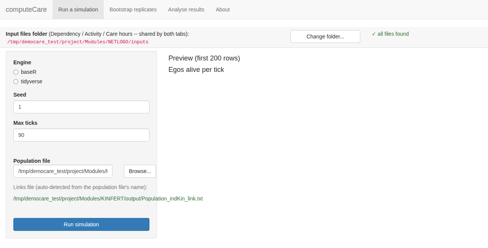

**Bootstrap replicates.**

The second tab runs the same resample-then-simulate loop as *computeCare\_baseR\_bootstrap.R* for a single population/links pair, driven from the form instead of edited by hand in the script’s CONFIGURATION block. Set the number of replicates, a base seed, an output file name root and an output folder, and click “Run bootstrap”. Each replicate is written as “\<root\>\_1\_\<i\>.txt”, ready for the “Analyse results” tab, or the functions described earlier in this section.

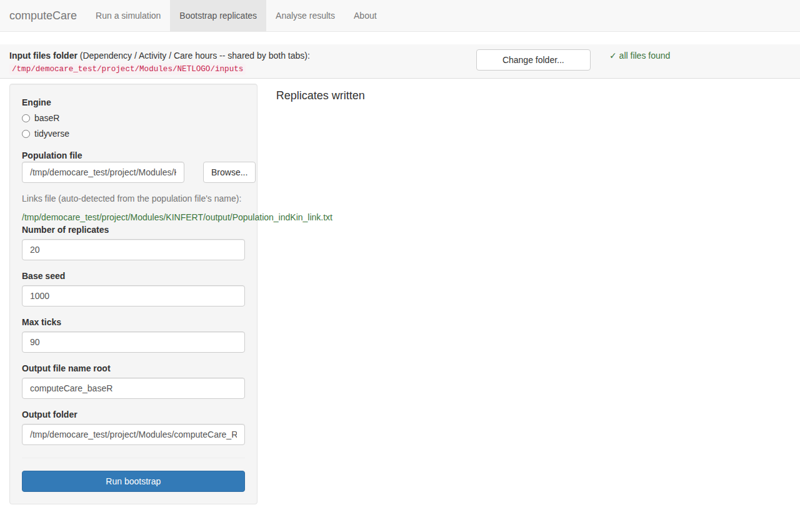

**Analyse results.**

The third tab is the last step before plotting: it turns the \*.dat/\*.txt files from either tab above into the three \*.RData files described earlier in this section. Choose “One simulation run” for a single file, or “Many bootstrap replicates” for a whole folder; in batch mode, pointing it at the folder is enough. It scans the file names there, works out which root name(s) and which range of replicates are present, and fills those fields in for you, marking any root whose files are not a complete run as “SOME MISSING”. Click “Build .RData files” and the three data frames are written to the chosen output folder and previewed underneath, so a mistake shows up immediately rather than only once *democare\_graphs.R* is run against it.

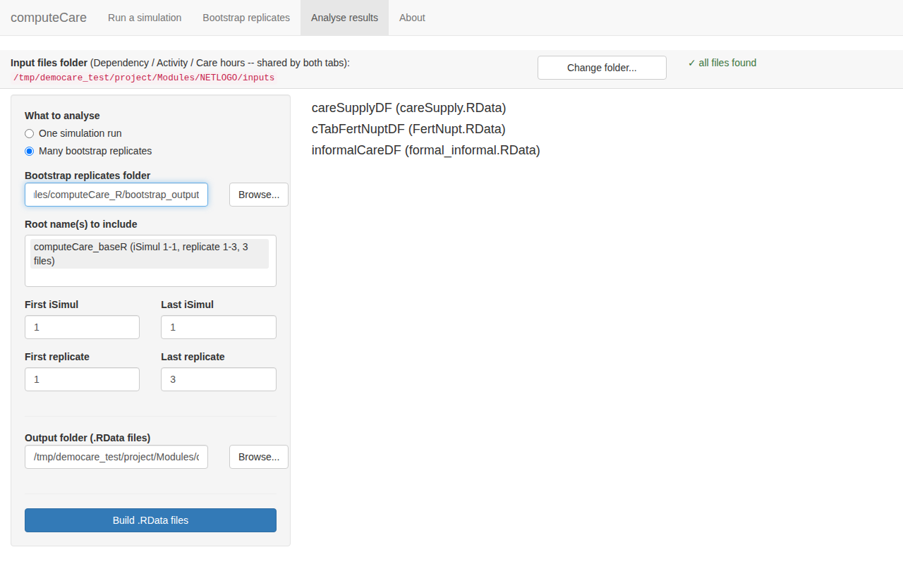

**About.**

The last tab is a short reference: what each shared setting does, where results are written, and a reminder that the app only calls the functions documented in this file.

## Acknowledgements

The R version of the second module, computeCare, was drafted with Claude Sonnet 5 through Cowork, working from the present documentation, and was then reviewed, corrected and tested against the NetLogo implementation.

## References

Calduch Verdiell, N., Zueras Castillo, P., Giménez de la Prada, A., Griera, O., Miguel Quesada, F. J., Devolder, D., and Spijker, J. (2017). Application of the Overview, Design concepts and Details (ODD): protocol to describe the DEMOCARE Agent Based Model. Papers de Demografia 456. Centre d’Estudis Demogràfics, Barcelona.

Efron, B., and Tibshirani, R. J. (1993). An Introduction to the Bootstrap. Chapman and Hall, New York.

James, G., Witten, D., Hastie, T., and Tibshirani, R. (2021). An Introduction to Statistical Learning with Applications in R, 2nd edition. Springer, New York. Available at statlearning.com.

Spijker, J., Devolder, D., and Zueras, P. (2022). The impact of demographic change in the balance between formal and informal old-age care in Spain. Results from a mixed microsimulation-agent-based model. Ageing and Society 42(3), 588-613. https://doi.org/10.1017/S0144686X20001026

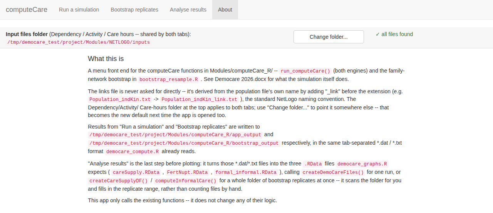
